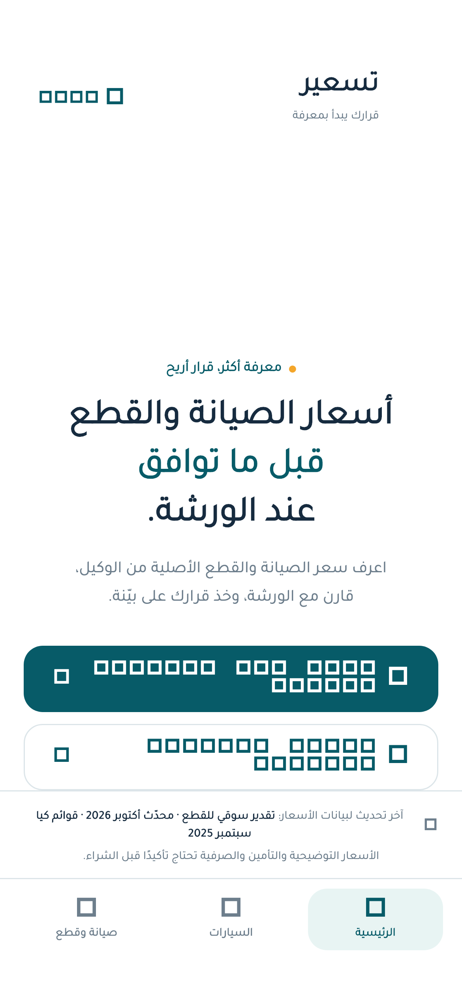
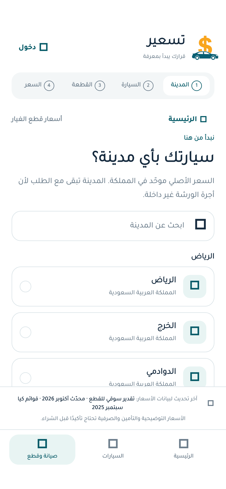
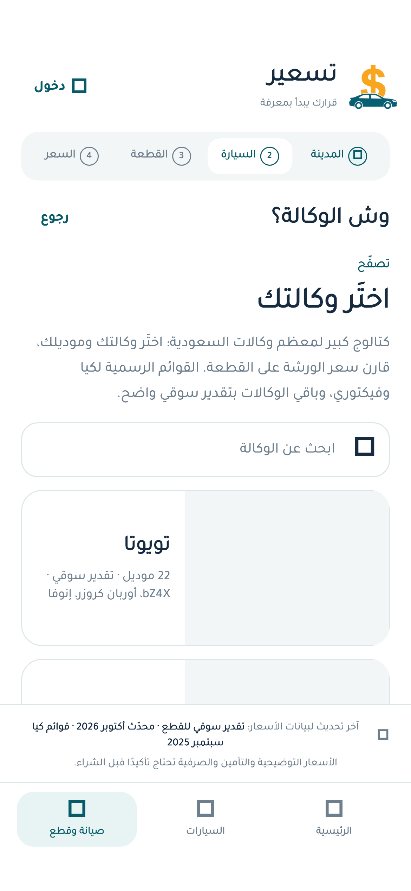
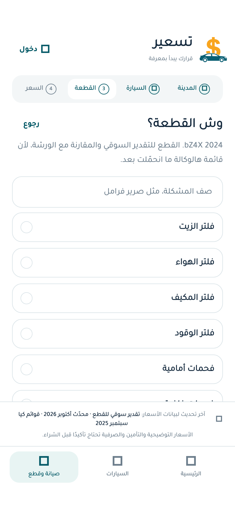
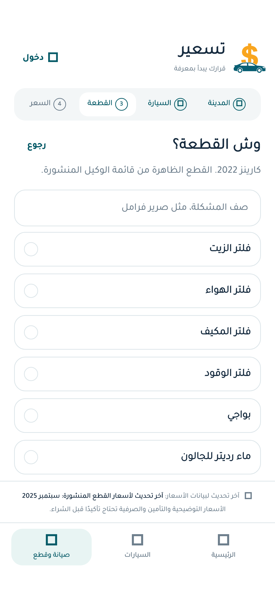
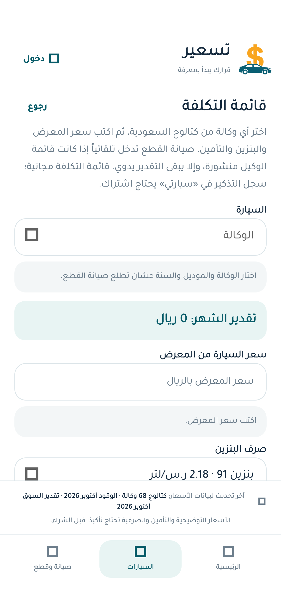

# تسعير

تطبيق Flutter لأسعار **الصيانة وقطع الغيار** في السعودية — داخل التطبيق فقط، بدون فتح مواقع الوكلاء.

اعرف سعر القطعة الأصلية (أو التقدير السوقي)، قارن مع عرض الورشة، وخذ قرارك على بيّنة.

<p align="center">
  
</p>

## لقطات من التطبيق

| الرئيسية | المدينة | الوكالات |
| :---: | :---: | :---: |
|  |  |  |

| القطع | قائمة كيا المنشورة | تكلفة السيارة |
| :---: | :---: | :---: |
|  |  |  |

## وش يقدّم؟

- كتالوج وكالات السعودية (تصفّح الماركات والموديلات داخل التطبيق)
- أسعار وكيل منشورة حيث توفرت (مثل كيا / فيكتوري)
- تقدير سوقي واضح للقطع لما ما تكون قائمة الوكيل محمّلة
- مقارنة عرض الورشة + نصيحة مبنية على المدى السعري
- قائمة تكلفة شهرية (معرض، بنزين، تأمين، صيانة)

## التشغيل

```bash
cd mobile
flutter pub get
flutter run
```

تفاصيل iOS / الخادم المحلي / الدوال: [`mobile/README.md`](mobile/README.md)

## الاختبارات (Harness)

من **جذر المستودع** (مو من داخل `mobile`):

```bash
./harness/run.sh all
```

الطبقات: اختبارات Flutter · فحوصات أمان ثابتة · smoke للـ API إن وُجد خادم حي.  
التفاصيل: [`harness/README.md`](harness/README.md)

## هيكل سريع

```
mobile/          تطبيق Flutter
server/          خادم تقارير محلي (Python)
supabase/        Edge Functions
harness/         تشغيل الاختبارات مجمّعة
docs/screenshots لقطات الواجهة
```

## تحديث اللقطات

```bash
cd mobile
flutter test tool/capture_screenshots.dart
```

الصور تُحفظ في `docs/screenshots/`.
